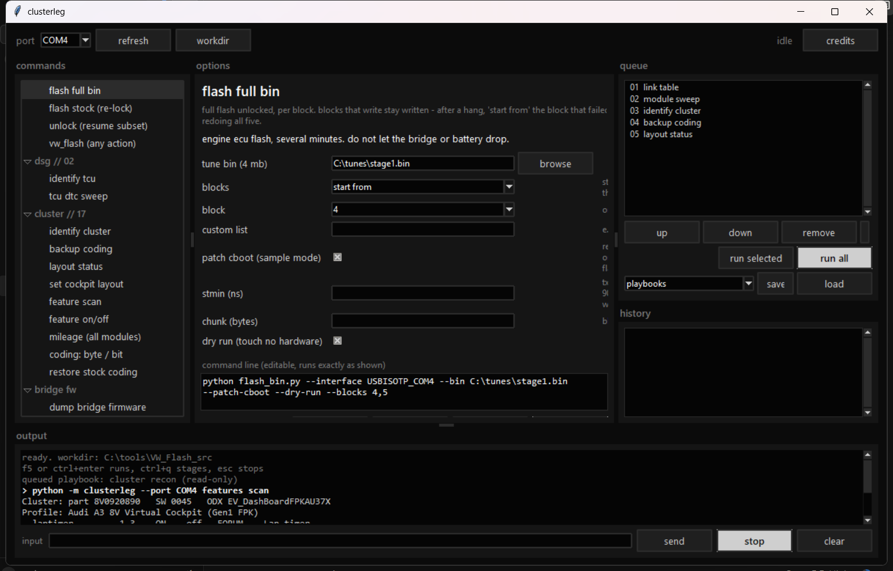
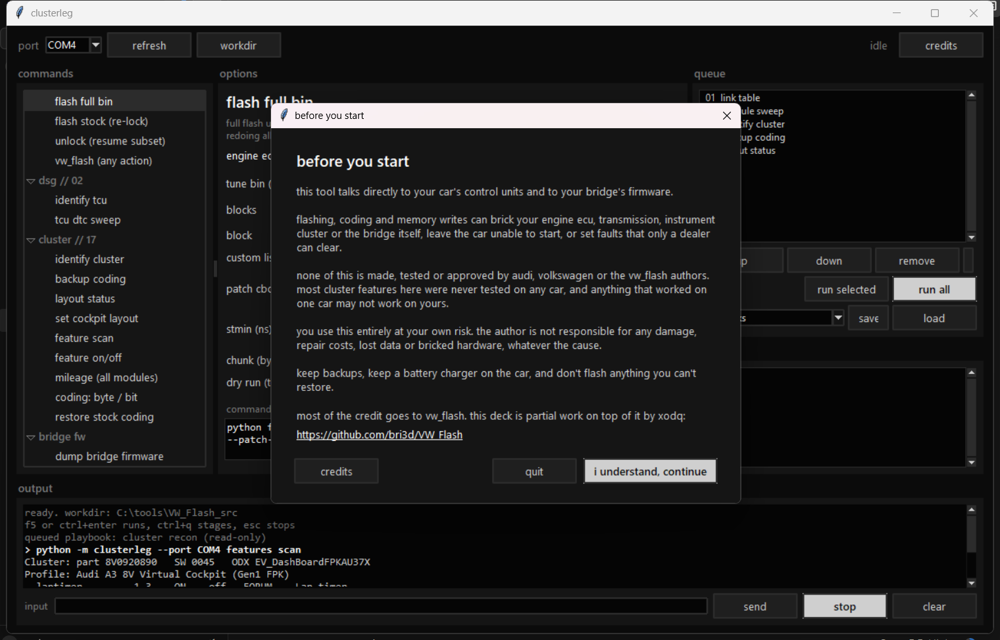

# clusterleg

Instrument cluster tools and a command deck for Audi/VW MQB cars, built on top of [VW_Flash](https://github.com/bri3d/VW_Flash) (most of the credit goes there), using the cheap DIY **ESP32 ISO-TP bridge** (Macchina A0 / AMAleg / Switchleg1 firmware) instead of a paid diagnostic app.

- **Virtual Cockpit sport layout**: switch Gen1 cockpits (A3 8V, TT 8S, ...) between standard, **S** and **RS** layouts
- **Long coding**: read, back up, change one byte or one bit, restore. Handles the VW coding login (F198/F199) for you
- **Passive listener**: record what OBDeleven/VCDS does to a module, decoded line by line
- **Bridge firmware**: dump and patch in a cluster link, checksum-verified (clusterleg never flashes the bridge)

Every write is a dry run until you add `--yes`, and every coding change is backed up first.

## Install

```bash
pip install -e .
```

Needs Python 3.9+. Close any other tool that holds the bridge's COM port.

## Quick start

```bash
clusterleg links                    # does the bridge firmware have a cluster link?
clusterleg probe                    # which modules answer?
clusterleg coding read              # save a backup of the cluster coding first
clusterleg layout read              # current layout
clusterleg layout set s             # dry run
clusterleg layout set s --yes       # write; then press VIEW on the wheel
clusterleg layout set standard --yes
```

If `links` shows no cluster link, the stock bridge firmware drops cluster traffic. clusterleg can prepare a patched image, but it never flashes the bridge; writing it to the ESP32 is up to you.

```bash
clusterleg fw dump                                      # read-only: your restore file
clusterleg fw patch bridge_app_factory_0x10000.bin patched.bin   # offline
```

## Ops deck (GUI)

Double-click **`clusterleg-deck.bat`** (it installs the Python dependencies on first run), or:

```bash
clusterleg deck
```





A dark command deck for everything above plus all of VW_Flash: ECU info, DTC sweeps, logger, CAL/bin/FRF flashing with **start-from-block / single-block** picking for hung flashes, unlock resume, DSG reads, and the cluster tools.

- Every button builds a plain command line you can read and edit before it runs
- Stage commands into a queue, save them as playbooks, and run them in order (the queue stops on the first failure)
- Write and flash commands stay locked until you **ARM** the deck; flashes also need you to type `FLASH`. The deck disarms after each run, and dry runs never need arming
- STOP sends a real Ctrl+C, so loggers and the passive tap close their files cleanly
- Expects the VW_Flash source folder next to this repo (change it with ⚙ WORKDIR)

## Cluster features and mileage

```bash
clusterleg features scan --backup <stock file>                         # read-only: every known feature ON/off vs stock
clusterleg features set a3_8v_fpk:gmeter on --backup <stock file>      # dry run
clusterleg mileage                                                     # odometer stored in each module
```

Features belong to **profiles** that only apply to the matching cluster (checked by ODX id and part number):

- `a3_8v_fpk`: Audi A3 8V cockpit 8V0920890, the reference car
- `audi_gen1_fpk`: other Audi Gen1 cockpits (TT 8S, A4 B9, A5 F5, Q5 FY, Q7 4M, Q2), not tested here

Each feature is tagged TESTED, FORUM, CONFLICT (sources disagree) or LOCKED (never written). Writing to a cluster that doesn't match the profile is refused unless you pass `--any-car`. `coding restore` puts stock back.

## Coding

```bash
clusterleg coding write --backup <file> --byte 1 --bit 3 --on      # lap timer (dry run)
clusterleg coding write --backup <file> --byte 1 --bit 3 --on --yes
clusterleg coding restore --backup <file> --yes
```

| Byte / bit | What it does | Notes |
|---|---|---|
| 1 / 3 | Lap timer | The guides list it as a requirement for the sport layout |
| 10 / 2 | G-meter (sport computer) | Can read 0 on cars without the sensor data |
| 15 / 4 | Engine data display | Power/torque may read 0 on non-RS cars |
| 2 | Car variant | **Leave stock.** Changing it altered the range estimate |

## How the sport layout works

It isn't in long coding. It's one byte in cluster EEPROM:

| Step | Request | Meaning |
|---|---|---|
| 1 | `10 03`, `10 4F` | extended, then development session |
| 2 | `27 03` / `27 04 <seed + 20103>` | security access, login 20103 |
| 3 | `23 14 03 00 3C 09 02` | read: `<layout> 57` |
| 4 | `3D 14 03 00 3C 09 02 <layout> 57` | write: `00` standard, `01` S, `03` RS |
| 5 | `11 01` | reset so the cluster loads it |

`clusterleg` only ever touches those two bytes, and it refuses to write unless they already look like the layout setting.

## Compatibility

| Car | Cluster | SW | Result |
|---|---|---|---|
| Audi A3 8V (2017, US) | 8V0920890 | 0045 | S layout works |

Guides list cluster SW 0069+ for the A3, but 0045 worked here. Please add your car.

## Tests

```bash
python -m unittest discover -s tests
```

The tests run against a simulated cluster (`tests/fake_cluster.py`), so no car is needed.

## Credits

**Most of the credit goes to [VW_Flash](https://github.com/bri3d/VW_Flash)** by Brian Ledbetter (bri3d) and contributors. All the engine and transmission flashing, unlocking, logging and DTC work this project runs is theirs; the bridge transport in `clusterleg/bridge.py` is adapted from it (BSD-2). Go check it out and star it.

The cluster tools and the deck are partial work added on top by [**xodq**](https://github.com/xodq) (aka xoddx).

- [VW_Flash](https://github.com/bri3d/VW_Flash): flashing, unlock, logging, DTCs
- [esp32-isotp-ble-bridge](https://github.com/bri3d/esp32-isotp-ble-bridge): the ESP32 bridge firmware VW_Flash talks through
- [dx.dragan.ba](https://dx.dragan.ba/audi-sport/) and [mqb.pl](https://mqb.pl/en/sport-layout-activation-on-audi-virtual-cockpit/): the Virtual Cockpit sport layout procedure
- The AMAleg / Macchina A0 hardware community

## Disclaimer

Not affiliated with Audi or Volkswagen. Writing to control modules can cause faults; you use this at your own risk. Keep your backups.
